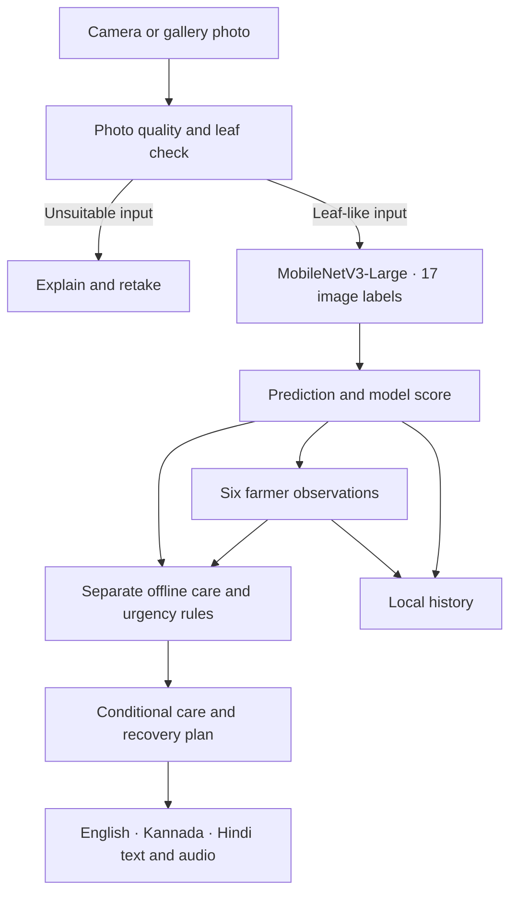

# AgriScan — Offline Crop Health

AgriScan is an Android and browser prototype for checking leaf photos and reading crop-care guidance. Disease inference runs on the device. It supports tomato, potato, and maize, with English, Kannada, and Hindi text and bundled audio.

> **Prototype limitation:** the image model has not been validated for field diagnosis. Treat its output as a suggestion to inspect, not a confirmed disease identification. Care instructions are conditional prototype guidance and have not been reviewed by an agronomist. Seek local agricultural advice before disease-specific treatment.

## Try AgriScan

- **Browser app:** [salecha-codes.github.io/Build_Beyond](https://salecha-codes.github.io/Build_Beyond/)
- **Source code:** [github.com/salecha-codes/Build_Beyond](https://github.com/salecha-codes/Build_Beyond)
- **Project report:** [Hackathon Final Report PDF](https://salecha-codes.github.io/Build_Beyond/downloads/Hackathon_Final_Report.pdf)

The browser downloads its model, runtime, content, and audio the first time it is opened. Wait for **Offline ready** before disconnecting. After the assets are cached, the service worker supports offline reload and inference. Browser storage is local to that browser and device.

From Home, choose **Try a sample leaf photo** to run a bundled potato late-blight example through the same photo review and on-device inference flow. The app labels it as a training-set demo and does not offer to save or share it as a farmer scan. The image provenance and license are recorded in [`content/samples/README.md`](content/samples/README.md).

The native Android app bundles its model, content, and audio in the APK. It does not need a server or internet connection at runtime. Android requests camera access when needed and does not request Internet permission. To build and install it, follow [Build and install AgriScan](docs/BUILD_ANDROID.md).

## What it does

1. Choose tomato, potato, or maize; take a photo or select one from the gallery.
2. The app checks photo quality and whether the image looks like a leaf. It asks for another photo when the input is unsuitable.
3. A bundled MobileNetV3-Large model ranks 17 supported condition labels. The app shows the model output and score with uncertainty language; a high score is not proof of a correct diagnosis.
4. Answer six questions about visible damage, spread, affected plants, wilting, fruit or stem symptoms, and wet weather.
5. A separate offline advisory system summarizes the reported damage and suggests when to recheck or seek help. It does not calculate severity from the photo or classifier score.
6. Review condition-specific care and recovery steps, play guidance in English, Kannada, or Hindi, and save the observation locally.

The searchable **Care library** can also be used without a photo. A manually selected condition is clearly marked as a library choice; it does not change a scan, photo, prediction, or saved record. Unknown answers do not silently select the mild-care pathway.

## Features

- Local photo inference with an ONNX MobileNetV3-Large image model and leaf/object input check.
- Optional bundled training-image demo for trying the browser flow without selecting a photo; clearly marked and excluded from scan history.
- Tomato, potato, and maize support across 17 image labels.
- Six farmer-reported symptom questions and a separate condition/urgency rule system.
- Care protocols in three languages: confirmation checks, look-alikes, immediate steps, treatment options, limitations, prevention, recovery and failure signs, and follow-up checkpoints.
- Bundled English and Hindi Piper speech and Kannada AI4Bharat Indic-TTS speech; no runtime speech API is required.
- Local history: Android Room/SQLite; browser IndexedDB.
- No cloud inference, photo upload, account, or paid API is required.

## How the system is organized



The Android client is Kotlin/Jetpack Compose with CameraX, ONNX Runtime Android, and Room. The browser client is React/TypeScript with ONNX Runtime Web and IndexedDB. Both package the shared ONNX model and content. The optional Node host serves static browser files and a health endpoint; it does not receive photos or perform inference.

### Repository map

| Path | Contents |
|---|---|
| `android/` | Native Android UI, camera, local inference, and persistence |
| `frontend/` | Browser UI, local inference, care flows, and offline support |
| `backend/` | Static preview host and health endpoint |
| `models/` | Shared ONNX model, labels, policies, model card, and evaluation receipts |
| `ml/` | Data preparation, training, evaluation, model export, and reliability tools |
| `content/` | Care protocols, translations, audio scripts, and asset manifests |
| `contracts/` | Stable label taxonomy and model preprocessing fixtures |
| `database/` | Android Room and browser IndexedDB schemas |
| `docs/` | Architecture, setup, research, evaluation, and validation notes |
| `scripts/`, `tools/` | Asset synchronization, offline packaging, and model/care build tools |

See [repository architecture](docs/REPOSITORY_STRUCTURE.md) for the full source layout.

## Image model and data

The current image classifier is **MobileNetV3-Large** with a trained 17-class disease head and an additional leaf/object check. MobileNetV4 was evaluated but was not selected for the shipped model: on the repository's frozen comparison it scored lower on the reused field-like set. See the [model card](models/assets/model/MODEL_CARD.md) and [training receipts](ml/reports/field_upgrade_v3/) for artifact details.

The primary dataset is the RGB subset of [PlantVillage](https://github.com/spMohanty/PlantVillage-Dataset). The inventory has **24,164 available files before deduplication** across three crops and 17 categories. After removing 14 exact duplicates, the audit records 24,150 unique source images. Training also used a documented subset of PlantDoc field images and 448 additional maize Healthy images. The exact splits and experiment data are in the [dataset audit](docs/DATASET_AUDIT.md) and [ML documentation](ml/README.md).

| Crop | Labels | Available RGB files before deduplication |
|---|---:|---:|
| Maize | 4 | 3,852 |
| Potato | 3 | 2,152 |
| Tomato | 10 | 18,160 |
| **Total** | **17** | **24,164** |

The 17 labels are: maize—gray leaf spot, common rust, northern leaf blight, healthy; potato—early blight, late blight, healthy; tomato—bacterial spot, early blight, late blight, leaf mold, Septoria leaf spot, spider-mite symptoms, target spot, yellow leaf curl virus, mosaic virus, healthy.

### Evaluation and limits

- The repository reports **92.27% accuracy** on 3,674 PlantVillage source test images.
- On a reused **80-photo PlantDoc field-like comparison**, the current model scored **38.75%**. This small, reused set indicates weak field generalization and is not a blind independent field trial.
- The separate leaf/object check rejected 125/125 held-out object/animal sample images in its recorded test. This does not guarantee rejection of every unseen object or non-crop leaf.
- Field diagnosis is not validated. Actual memory, speed, battery use, and camera behavior on physical 3–4 GB phones have not been measured.
- Reliability and acceptance tooling is available in the repository. Metrics from existing receipts have limits; see the [evaluation notes](docs/MODEL_RETRAINING_VALIDATION.md) and [evaluation receipts](ml/reports/field_upgrade_v3/).

Do not present the source-dataset score as field accuracy. Do not use the app's output alone to choose a pesticide or treatment.

## Care, severity, and recovery guidance

The advisory system is a separate authored decision model, not a trained severity neural network. It combines the selected or predicted condition with farmer-reported observations. It keeps uncertainty explicit and distinguishes damage from urgency; for example, a limited visible area can still call for prompt expert advice for a high-risk suspected condition.

The canonical [care protocol library](content/care_protocols.json) covers all 17 labels in English, Kannada, and Hindi. Each protocol has confirmation checks, look-alikes, care options, limitations, avoidances, recovery/failure signs, follow-ups, and adviser questions. Actions are conditional and do not promise a cure. No medicine dose is generated from a photo. The guidance and translations still need agronomist and native-speaker review; see the [care research](docs/CARE_V2_RESEARCH.md) and [treatment model card](models/advisory/TREATMENT_MODEL.md).

## Build and run locally

### Browser

Requirements: Node.js 22 or newer.

```sh
npm ci
npm run build
npm start
```

Open `http://localhost:3000`. For hot-reload development, run `npm run dev` and open `http://localhost:5173`.

### Android

Requirements: JDK 17 and Android SDK Platform 35. Configure `ANDROID_HOME` or `local.properties`, then run:

```sh
./gradlew :app:assembleDebug
```

To run the unit tests and build the Android test APK:

```sh
./gradlew :app:assembleDebugAndroidTest :app:testDebugUnitTest
```

See [Android build instructions](docs/BUILD_ANDROID.md) for SDK setup, ABI-specific APKs, installation, and device tests. A debug APK requires allowing installation from the file source when sideloaded.

### Shared assets

The shared model, labels, protocols, and audio are copied and validated during the build. To rebuild the care protocol package:

```sh
python3 tools/build_care_protocols.py
```

To inspect model bundle synchronization options:

```sh
python3 tools/sync_model_bundle.py --help
```

## Privacy and data storage

Photos are processed locally and are not uploaded for diagnosis. Android observations use the app's private Room/SQLite database and photo storage. Browser observations use IndexedDB and browser-managed local storage. Clearing app/browser data removes the corresponding local history; there is no cloud backup or cross-device sync.

## Further documentation

- [Architecture](docs/ARCHITECTURE.md)
- [Build and install Android](docs/BUILD_ANDROID.md)
- [Dataset audit](docs/DATASET_AUDIT.md)
- [Model card](models/assets/model/MODEL_CARD.md)
- [Evaluation and validation](docs/REVIEW2_VALIDATION.md)
- [Care and treatment research](docs/CARE_V2_RESEARCH.md)
- [Public project report](https://salecha-codes.github.io/Build_Beyond/downloads/Hackathon_Final_Report.pdf)
