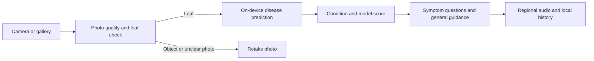

# Offline Crop Health — Build Beyond ’26

Android application and interactive browser preview for **PS 4.1**, built for Team Debuggers. The white/lavender/purple screens follow the supplied Figma screenshots. Both clients execute the same bundled MobileNet model locally.

## Review 2 submission

**Team Debuggers · Team 8 · Problem Statement 4.1**

Current prototype: **v0.4.3**, with an offline MobileNetV3-Large disease model and a leaf/object check. It supports tomato, potato and maize, English/Kannada/Hindi audio, symptom questions, general precautions and local history.

[Open the browser demo](https://salecha-codes.github.io/Build_Beyond/) · [Review 2 implementation and checks](docs/REVIEW2_SUBMISSION.md)



## Repository structure

| Directory | Responsibility |
|---|---|
| [`frontend/`](frontend/) | React/TypeScript browser preview, screens, local inference, offline cache and browser storage |
| [`backend/`](backend/README.md) | Node preview host and health endpoint; no photo uploads or remote diagnosis |
| [`models/`](models/README.md) | Canonical ONNX model, class order, metadata, policy, checksum and model card, shared by Android and web |
| [`database/`](database/README.md) | Actual Android Room/SQLite schema and browser IndexedDB schema/documentation |
| [`android/`](android/) | Native Kotlin/Compose app, CameraX, application logic, Room and ONNX Runtime Android |
| [`ml/`](ml/README.md) | Dataset acquisition, training, calibration, export and recorded results |
| [`content/`](content/README.md) | Trilingual content and reproducible offline audio generation |
| [`contracts/`](contracts/) | Stable 17-class taxonomy and independent preprocessing fixtures |
| [`scripts/`](scripts/) | Shared-asset synchronization and offline web packaging |
| [`docs/`](docs/) | Architecture, setup, demonstration and validation records |

See [repository architecture](docs/REPOSITORY_STRUCTURE.md) for the request/data flow. A central database is unnecessary: browser history stays in IndexedDB and Android history stays in Room/SQLite.

## Run the browser preview

Use Node.js 22 or newer:

```sh
npm ci
npm run build
npm start
```

Open `http://localhost:3000`. For development, run `npm run dev` and open `http://localhost:5173`.

The first browser visit downloads the model, WASM runtime, content and audio. Wait for **Offline ready** before disconnecting. The service worker then supports offline reload and local inference. Browser and Android histories are separate device-local stores. Browser performance is not a native-phone benchmark.

## What is implemented

- Camera capture and gallery import with bounded decoding and EXIF orientation.
- Local **MobileNetV3-Large** inference through ONNX Runtime, with 17 tomato, potato, and maize condition labels.
- Photo-quality checks, real ranked scores, and explicit uncertain results.
- Three questions about observed symptoms, producing a user-reported concern level.
- English, Kannada and Hindi interface and general precautions, with **90 bundled neural-voice audio clips**: AI4Bharat Indic-TTS for Kannada and Piper for English/Hindi. Playback requires no speech API, installed language pack or phone TTS model. The selected language is remembered locally.
- Room-backed Android history and IndexedDB-backed browser history, with crop filters and targeted deletion.
- Offline help and model status. The installed Android app requests camera permission and has **no Internet permission**; the browser downloads assets on its first visit.

The target is Android 7.0+ on 3–4 GB RAM phones. Actual ARM-phone memory, latency, camera behavior, and Kannada pronunciation still require a physical-device check.

## Dataset used — 17 categories

We used the RGB subset of the [PlantVillage dataset](https://github.com/spMohanty/PlantVillage-Dataset) covering **tomato, potato and maize**. The counts below describe the available source files **before deduplication**, rather than the number of training images in every model experiment.

| Crop | Categories | Available RGB files |
|---|---:|---:|
| Maize | 4 | 3,852 |
| Potato | 3 | 2,152 |
| Tomato | 10 | 18,160 |
| **Total** | **17** | **24,164** |

| Crop | Condition category | Files before deduplication |
|---|---|---:|
| Maize | Gray leaf spot | 513 |
| Maize | Common rust | 1,192 |
| Maize | Northern leaf blight | 985 |
| Maize | Healthy | 1,162 |
| Potato | Early blight | 1,000 |
| Potato | Late blight | 1,000 |
| Potato | Healthy | 152 |
| Tomato | Bacterial spot | 2,127 |
| Tomato | Early blight | 1,000 |
| Tomato | Late blight | 1,909 |
| Tomato | Leaf mold | 952 |
| Tomato | Septoria leaf spot | 1,771 |
| Tomato | Spider-mite symptoms | 1,676 |
| Tomato | Target spot | 1,404 |
| Tomato | Yellow leaf curl virus | 5,357 |
| Tomato | Mosaic virus | 373 |
| Tomato | Healthy | 1,591 |

Removing 14 exact duplicates left **24,150 unique source images**, partitioned into 16,856 TRAIN, 2,228 TUNE, 1,392 calibration and 3,674 TEST images. The current V3 disease head used a capped subset of **6,324 PlantVillage TRAIN images, 632 PlantDoc field TRAIN images and 448 additional maize Healthy field TRAIN images**. Additional PlantDoc tuning/calibration/test photos and a separate leaf/object dataset support evaluation and input screening. See the [dataset audit](docs/DATASET_AUDIT.md), [training receipts](ml/reports/field_upgrade_v3/) and [leaf-check receipts](ml/reports/leaf_guard/) for the exact experiment scope.

## Leaf input check

The model first checks whether the photo looks like a leaf. Rejected object photos return a retake request with **no disease name or score**. The leaf head shares the same offline backbone and adds about 15 KB.

A frozen threshold rejected 125/125 held-out object/animal test photos, including computer mouse, hamster, cat, laptop and monitor. It retained 77/80 field leaf photos and all 31 correctly classified field cases, preserving 38.75% end-to-end field accuracy on the reused benchmark. The corrected leaf threshold retains all source test leaves; disease-classifier accuracy is 92.27%. These are sample measurements, not universal guarantees; other plant leaves may still pass. See [leaf-check receipts](ml/reports/leaf_guard/) for data/protocols and limitations. Test photos are not bundled in the app.

## Model status

The current model is **MobileNetV3-Large**, using official ImageNet-pretrained visual features and a trained 17-class disease head with TRAIN-only feature standardization embedded in ONNX. It replaces MobileNetV4 after tuning and frozen evaluation showed a stronger field result. The exact FP32 ONNX graph is 11,965,503 bytes and outputs 17 disease logits, 960 visual features and one leaf-check logit.

The following table measures the disease classifier before the separate leaf check.

| Same frozen comparison | Images | V4 accuracy | Current V3 accuracy |
|---|---:|---:|---:|
| PlantVillage source | 3,674 | 94.67% | 92.27% |
| PlantDoc field-like | 80 | 22.50% | 38.75% |

Field recognition improves by 16.25 percentage points (18 → 31 correct out of 80). **Field accuracy is still limited.** This 80-photo set was already used for V4; it is a reused comparison benchmark, not newly blind independent data. Source accuracy must not be presented as field accuracy. External labels are mostly unreviewed.

Classifier-only accepted precision on source images is 96.72% at 85.44% coverage. Field accepted precision is 52.63% at 47.50% coverage. Field validation and condition-specific advice remain false. Both apps show the actual predicted condition, with low-confidence or crop-mismatch labels when applicable; numeric gates and global 17-class score semantics remain intact.

SHA-256: `31b29158cc1fc1c07bdf3acc07cb6bb6da39eccb1050ffe6ed1d499811179fba`.

See [current training/evaluation receipts](ml/reports/field_upgrade_v3/) and [model card](models/assets/model/MODEL_CARD.md). Earlier V4 reports remain historical.

## Diagnosis workflow fixes

Version0.4.3 corrects two causes of missing output: an unnecessarily strict leaf threshold and hiding a genuine leaf’s uncertain disease candidate. The binary leaf check still precedes any disease display. Leaf-passed unfamiliar results now show the real closest model candidate and score with explicit uncertainty; disease acceptance gates remain intact. Clear photos down to128px can run (224px+recommended); blur and exposure checks remain.

Threshold selection now searches TUNE score intervals. Field TUNE leaf recall rises132/138→137/138 while104/104 TUNE objects stay rejected. Reused comparison:125/125 objects remain rejected and77/80 field leaves pass. This is an input/workflow fix; it does not increase the classifier’s38.75% disease accuracy or turn predictions into confirmed field diagnoses. Older cached browser pages refresh when the new offline bundle activates. See ml/reports/diagnosis_workflow_fix and model card.

## Latest targeted field-data update

The latest head adds 448 audited maize Healthy field photos. The existing 80-photo disease benchmark remains 31/80 (38.75%). On a separate, small 14-photo healthy-maize test, the old model made zero correct visible predictions and the updated model made one provisional correct prediction; neither produced a strict accepted Healthy result. This is a small targeted gain, not a broad accuracy breakthrough. The leaf/object check is preserved. See [exact comparison and provenance](ml/reports/healthy_field_update/) and [dataset tooling](ml/KANDAHAR_DATA.md). Broad new Blight/Spot labels were excluded from the 17-class disease training.

## Build and try it

See [Android build instructions](docs/BUILD_ANDROID.md). With JDK 17 and Android SDK 35 configured, run from the repository root:

```sh
./gradlew :app:assembleDebug :app:testDebugUnitTest
```

Phone outputs are in `android/app/build/outputs/apk/debug/`: use `app-arm64-v8a-debug.apk` for most current Android phones, or `app-armeabi-v7a-debug.apk` for a 32-bit device. `app-universal-debug.apk` contains all supported ABIs. These are debug-signed prototype builds.

For a demonstration, enable airplane mode, open the app, choose the crop, scan or import a clear leaf photo, and run the assessment. Review its actual model match or uncertain result. Complete the symptom questions, play English/Kannada/Hindi audio, save the observation, and reopen it from History. The production app starts with empty history.

## Additional experiments

The current shipped model remains the leaf-guarded V3 model. Further neural-head, kernel-head and partial fine-tuning experiments are included for reproducibility. They did not improve the reserved field comparison enough to replace it. Tuning scores from these experiments are not deployed accuracy. See [experiment outcomes](ml/reports/additional_field_trials/STATUS.md).

## Validation and project references

- [Current Review 2 implementation and checks](docs/REVIEW2_SUBMISSION.md)
- [Earlier device evidence](docs/REVIEW2_VALIDATION.md)
- [Current architecture and tools](docs/ARCHITECTURE.md)
- [Current model receipts](ml/reports/healthy_field_update/)
- [Offline content and audio generation](content/README.md)
- [ML acquisition, training, and export](ml/README.md)
- [Product scope](docs/PRODUCT_SCOPE.md)
- [Dataset audit](docs/DATASET_AUDIT.md)
- [Review 1 presentation notes](docs/REVIEW_1.md)

Earlier planning documents describe intended release gates; the Review 2 validation record and current model receipts state what has actually been executed.
