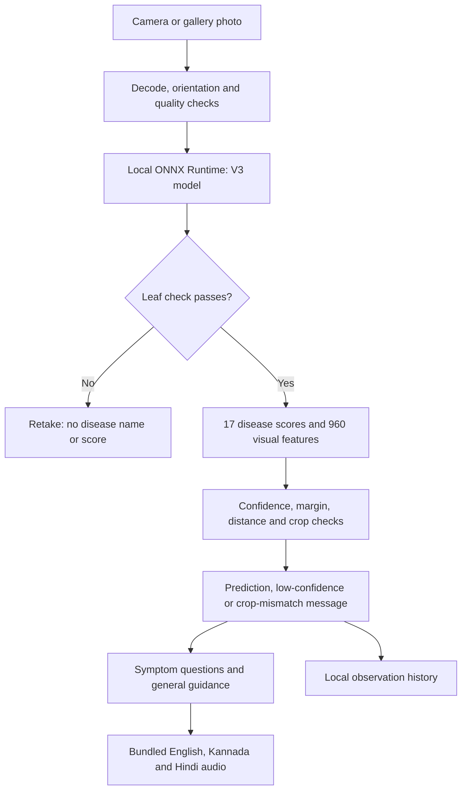

# Current prototype architecture

The native Android app and browser preview execute the same local MobileNetV3-Large ONNX graph. The model uses official ImageNet-pretrained visual features, a trained disease head and a leaf/object head. Earlier V4 experiments are historical; the current model and exact receipts are authoritative.

## Runtime flow

## Components

| Component | Implementation |
|---|---|
| Android UI | Kotlin, Jetpack Compose, CameraX and gallery import |
| Android inference | ONNX Runtime Android CPU, API 24+; no Internet permission |
| Browser UI/inference | React, TypeScript, Vite and ONNX Runtime Web WASM |
| Preview backend | Node static file server and health endpoint |
| Android data | Room/SQLite and app-private photo files |
| Browser data | IndexedDB, local preferences and service-worker cache |
| Speech | 90 bundled neural clips across English, Kannada and Hindi |
| Training/export | PyTorch/Torchvision pretrained V3 features; trained disease and leaf heads; ONNX checker/parity |

No server receives crop photos or performs diagnosis. Browser first load downloads the static model/runtime/audio; after Offline ready, cached operation is available. Native assets are packaged in the APK.

## Shared model contract

Canonical assets: `models/assets/model/`. Both clients use fixed 17-label ordering, RGB FP32 NCHW `[1,3,224,224]`, EXIF orientation, letterbox resizing, ImageNet normalization and the same 960-dimensional feature space. Graph outputs are `logits [1,17]`, `embeddings [1,960]` and `leaf_logit [1,1]`.

Metadata binds the model SHA, versions and output shapes. Source evaluation binds frozen temperature/class gates and centroid assets. Leaf validation binds its exact output, frozen threshold and test receipt. Missing/corrupt required evidence fails loading. Leaf/object rejection precedes presentation of disease candidates. Low-confidence results retain explicit uncertainty; the selected crop never silently forces a different disease score.

## Measured scope

Current graph SHA: `31b29158cc1fc1c07bdf3acc07cb6bb6da39eccb1050ffe6ed1d499811179fba`, size 11,965,503 bytes. Classifier-only accuracy is 92.27% on 3,674 source images and 38.75% on the reused 80-image field benchmark. With the leaf check, source end-to-end accuracy is 92.11%; field remains 31/80 = 38.75%.

The leaf check rejected 125/125 held-out object/animal samples and retained 76/80 field leaves. This is not a universal unseen-image guarantee. Field diagnosis, disease severity estimation and chemical prescriptions are not validated. Three symptom questions produce reported concern, not a photo severity measurement. Android 3–4 GB RAM is a target; physical ARM-phone RAM and latency require measurement.

See [submission guide](REVIEW2_SUBMISSION.md), [model card](../models/assets/model/MODEL_CARD.md), [leaf-check receipts](../ml/reports/leaf_guard/) and [historical V4 architecture](history/ARCHITECTURE_V4.md).

## Healthy field-data revision

The current head additionally trains on 448 Kandahar Healthy maize photos. The disease benchmark stays 31/80. On new Healthy TEST14, one correct provisional prediction is visible versus zero previously; neither model has strict accepted Healthy results. See ml/reports/healthy_field_update and ml/KANDAHAR_DATA.md. This small gain does not validate field-health diagnosis.
