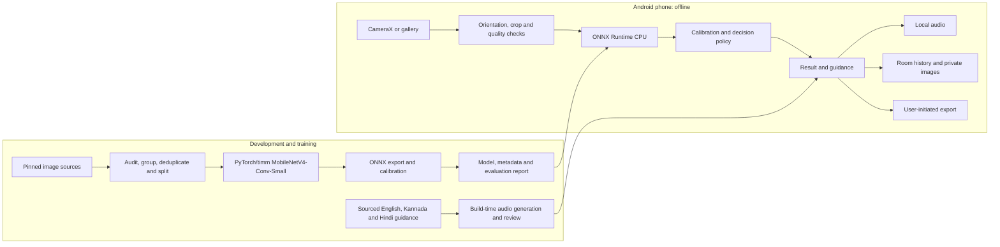

# Final architecture and tools

## Architectural decision

The Review 2 prototype is a **native Kotlin Android application** with local inference and content. It uses the user-selected **MobileNetV4-Conv-Small**, **PyTorch/timm for training, ONNX for model exchange, and ONNX Runtime Android for inference**. A server is unnecessary for the core product.

The earlier LiteRT proposal and V3 baseline are historical decisions, superseded by the user's V4 choice. A prior successful V3 weight-endpoint check does **not** establish V4 pretrained-weight availability. The inspected timm V4 configuration points to Hugging Face, which remained blocked; **no ImageNet pretrained weights were used**. The current model was trained from scratch and successfully exported/executed through ONNX Runtime. The Android 1.23.2 AAR declares API 24 and contains ARM32/ARM64 libraries; the app's ABI builds also passed. These facts do not establish physical-phone latency or RAM performance.

## Current prototype evidence

- All **24,164** selected source RGB files were downloaded, decoded and checked against their pinned Git blob hashes. Fourteen exact copies were excluded from use; source physical-leaf metadata remains incomplete.
- The bounded run used **2,152 training images** and **536 source-validation images**. It ran **15 scratch-training epochs** (3 initial, then 12 continued with a restarted optimizer); validation selected **epoch 14**.
- Selected source-validation accuracy is **60.45%**, macro F1 **0.5902**. These are model-selection validation results, **not held-out test or field accuracy**.
- The exact FP32 ONNX model is `mnv4-conv-small-supervised_from_scratch-d157e7c84013`, SHA-256 `d157e7c8401319a700039de467caba6728b7bdbf35b4cdae1818757cf0ba7e3c`, **10,032,309 bytes**. ONNX checking and PyTorch/runtime parity passed.
- Temperature **0.88579244** was fitted to actual exported-model source-validation logits; validation NLL changed **1.14515 → 1.13783**. The same validation subset was also used in model selection, so this is not independent field calibration.
- Both model metadata `diagnosis_validated` and policy `validated` remain **false**. Acceptance thresholds are provisional; the app must keep the unvalidated/uncertain outcome and must not enable condition-specific advice on these scores.
- A separate **older 3-epoch model** achieved **36.19%** on a 536-image held-out source-test subset versus **5.22%** for the untrained same-architecture graph. Those results belong only to that older artifact and are **not** the current model's test accuracy. The longer candidate was not selected by repeatedly inspecting that test.

Compact receipts are under `ml/reports/review2_3epoch/` and `ml/reports/review2_continued/`. Native execution and device-validation evidence belongs in the Review 2 validation report; no physical ARM-phone benchmark is claimed here.

**Platform baseline:** Android 7.0/API 24 or newer. Produce separate 32-bit and 64-bit ARM APKs and an x86_64 test build. No NPU, GPU delegate or Google Play Services download is required for CPU inference.

**Required hardware target:** phones with **3–4 GB total system RAM**. The app must use a small fraction of that memory, because Android and other apps share it. Start with a 200 MB whole-app peak-PSS engineering budget during capture, assessment and playback; this is a target, not a measured result. Record model/session memory separately from total app memory.

Use batch size one, one shared inference session, one assessment at a time, bounded image decoding (initial maximum decoded side 1,024 pixels), prompt bitmap/tensor release and initially two CPU threads. Benchmark one/two/four threads on real hardware before choosing the shipping setting. Phone inference remains CPU-first and does not include model training, an on-device LLM or a second large speech model.

## System diagram

Arrows from development represent files packaged into the APK, not network calls made by the phone.

## Tool choices

| Area | Selected tools | Role |
|---|---|---|
| Data audit | Python 3.12, Pillow, NumPy, pinned Git hashes | Actual decoding, known-group/exact deduplication and manifests; full perceptual/manual review remains pending |
| Training | PyTorch 2.9.1 CPU, timm 1.0.22, Torchvision 0.24.1 | Executed bounded V4 scratch training; pretrained transfer remains a follow-up if weights become accessible |
| Metrics/calibration | scikit-learn, NumPy, PyTorch | Per-class metrics, temperature fitting, confusion matrices and JSON receipts |
| Export | ONNX 1.18.0, ONNX Runtime Python 1.23.2 | Executed FP32 export, checker and runtime parity; INT8 comparison remains planned |
| Android UI | Kotlin 2.1.20, Jetpack Compose/Material 3 | Native accessible screens |
| Capture | CameraX 1.4.2 and Activity Result APIs | Camera and gallery input |
| Inference | ONNX Runtime Android 1.23.2 | Local CPU model execution |
| App state | ViewModel, StateFlow, Kotlin coroutines | Lifecycle-aware state and background work |
| History | Room 2.7.1, private files | Structured observations and owned images |
| Preferences | AndroidX DataStore | Language, onboarding and saved contact preferences |
| Structured assets | kotlinx.serialization JSON | Versioned labels, policy and advice |
| Audio | Android MediaPlayer / browser audio; build-time AI4Bharat Indic-TTS and Piper | Play bundled Kannada/English/Hindi neural narration; no phone TTS dependency or paid speech API |
| Build | JDK 17, Gradle 8.11.1, Android Gradle Plugin 8.9.2, SDK 35 | Reproducible APK builds |
| UI versions | Compose BOM 2025.04.01, KSP 2.1.20-1.0.32 | Stable dependency set with Room code generation |
| Tests | Pytest, JUnit, Compose UI tests, Android instrumentation | Data/model parity and meaningful user-flow checks |

The CPU ML environment is installed; `ml/requirements.lock` records the executed package set. Native application compilation and ABI builds passed with the selected Android dependencies. Use the official CPU wheel index for PyTorch, avoiding unnecessary CUDA packages on this machine. Build success is distinct from physical-phone or field validation. No paid inference API or API key is needed by the design.

## Model contract

- Model: timm `mobilenetv4_conv_small.e2400_r224_in1k`, structurally **MobileNetV4-Conv-Small**, with a 17-output classifier. The registry identifier names a configuration; it does not mean the current artifact inherited its pretrained weights. The executed prototype uses supervised scratch training, not a frozen pretrained backbone.
- Input: one RGB photo region; correct orientation, preserve aspect ratio with letterboxing to 224 × 224, and use fixed padding RGB `(124,116,104)` in both reference and Android implementations.
- Model-input resizing uses a Pillow-compatible separable antialiased bilinear implementation on Android, with the same pixel centers and per-axis 22-bit coefficient/8-bit rounding as training. The corrected native run matched both independent solid and textured 150,528-value tensor fixtures exactly (zero max/mean/p99 error). Preview and quality-check resizing may use Skia. These fixture checks do not claim that every Android/Pillow camera-image decoder is pixel-identical.
- Tensor: float32 NCHW `[1,3,224,224]`; scale pixel values to `[0,1]`, then use mean `[0.485,0.456,0.406]` and std `[0.229,0.224,0.225]`.
- Outputs: named `logits` `[1,17]` and `embeddings` `[1,960]`, measured from the V4 implementation. Read the embedding dimension from metadata rather than retaining the superseded V3 dimension. The 960-value pooled feature output is available for future empirical unfamiliar-input gating.
- Export: fixed-shape ONNX, opset 17 and IR 8 for the current artifact. Python ONNX checking and PyTorch/ONNX Runtime output parity passed; all 536 selected validation logits were also compared against the selected checkpoint. This is graph-execution evidence, not recognition accuracy or full Android pixel-preprocessing equivalence.
- Calibration: the current scalar temperature was fitted on source-validation data also used for model selection. Neither acceptance thresholds nor an independent calibration set are validated. Each future candidate needs its own evaluated temperature, thresholds and any centroids; quantization must not inherit them without checking.
- Unfamiliar-input gate: centroid/distance gating remains a planned extension; the present bundle does not supply a validated unknown detector. Confidence, margin and crop checks do not guarantee rejection of every unfamiliar image. The current mandatory unvalidated-model gate takes precedence.
- Selected crop is checked against the global top class. Do not mask and renormalize probabilities to force a confident answer for the selected crop.
- Quantization: the Review 2 bundle is **FP32**. A future static-QDQ INT8 comparison must use representative training calibration inputs, keep the input/output contract consistent and measure accuracy/resource changes. No INT8 accuracy, size or speed result has been achieved by this run.

FP32 is the current packaged prototype choice. INT8 is a future measured optimization, not a result implied by a smaller expected file size.

## Decision state machine

`Idle → CropSelected → PhotoReady → QualityCheck → Assessing → Result`.

Result types: `LikelyCondition`, `HealthyLooking`, `CropMismatch`, `Uncertain`, or `RecoverableFailure`. Poor quality returns a retake action. Failures such as unreadable images or missing/corrupt assets are explicit and never converted into a prediction.

Initialize one app-scoped OrtSession. Run one assessment at a time off the UI thread, initially with two CPU threads; benchmark alternatives. Decode a bounded-size bitmap rather than loading an unrestricted camera image into memory. Release tensors and cursors after use, cancel stale work, and preserve results across UI recreation.

## Packaged artifacts

Under `assets/model/`: `crop_model.onnx`, `labels.json`, `model_metadata.json`, `decision_policy.json`, model card and export receipt. Structured guidance/audio metadata live under `assets/content/`; versioned English/Kannada/Hindi clips live under `assets/audio/`. Metadata records the model SHA-256, preprocessing, class order, runtime compatibility and model version. Policy carries temperature and the explicitly false diagnosis-validation gate; full training/calibration receipts are retained in the ML evidence directories.

Validate asset integrity and version alignment at startup. Missing audio should leave readable guidance available with a clear playback error. A model/label mismatch disables assessment; it must not silently mislabel results.

## Data structures

- **Condition:** stable ID, crop ID, category type (disease/pest/healthy), source label, localized names, support status and source references.
- **Guidance:** condition ID, content version, language, symptom checklist, action/prevention/escalation text, source verification status and local audio reference.
- **Observation:** ID, local timestamp, selected crop, private image path, outcome, predicted class, calibrated confidence, rejection reason, model/policy/content versions and measured inference duration.
- **Model metadata:** model hash/version, ordered labels, preprocessing, ONNX opset/IR, calibration and gate references.

Images live in app-private storage; Room stores paths and structured observations. A transaction coordinates observation creation with owned-file handling. Deletion removes the observation and its owned image. Exports use Android FileProvider grants for the selected file rather than exposing the entire image directory.

## Offline boundary

Bundle the runtime, model, guidance and audio in the installed APK. Assert that the merged app manifest does not request INTERNET. Inference and advice have no HTTP client. Sharing or opening the system dialer is user initiated and outside the offline diagnosis guarantee. Build-time downloads do not imply phone runtime connectivity.

## Content and audio pipeline

Maintain source-backed English records, translate them to Kannada, check semantics and pronunciation, then generate short local audio clips. The current narration uses AI4Bharat Indic-TTS FastPitch/HiFiGAN for Kannada and Piper LJSpeech VITS for English and Pratham VITS for Hindi. Concise spoken scripts are versioned separately from longer screen copy. Generation runs locally during development; only normalized 24 kHz mono OGG outputs are packaged. The former eSpeak clips were replaced after user feedback about clarity. Technical decode/checksum checks do not establish native-speaker pronunciation quality, which remains a listening-review task.

Advice records have a verification flag. Unverified condition-specific treatment is not enabled. A generic retake/consultation message remains available. UC IPM and TNAU are selected primary advisory sources to consult, but their pages were blocked in this environment and have not been read. Source availability and translation review are content-validation gates, not reasons to change the offline architecture.

The feature presentation adds symptom-based severity/concern guidance. This is a separate symptom checklist requiring source/language review, with local text/audio prompts, not an output of the 17-class disease model. Store reported symptoms and the rule/content version with any concern result. Current datasets do not supply severity labels; a validated photo-based severe/not-severe classifier is not claimed. Until concern rules are reviewed, display the observations and expert-follow-up guidance rather than an unsupported severity label.
