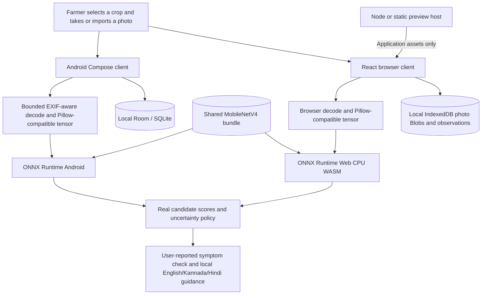

# Repository architecture

The product has two clients: the native Android application and a browser preview. Both execute the canonical MobileNetV4 ONNX bundle on the user's device. The browser host serves application files; it does not receive crop photos or run diagnosis.

```text
Build_Beyond/
├── frontend/                 React + TypeScript browser client
│   ├── src/components/       Shared UI components and local audio player
│   ├── src/lib/              Inference, content, concern rules, IndexedDB, offline hook
│   ├── src/App.tsx           Screen state and user workflows
│   └── tests/                Real Chromium/ONNX and offline integration checks
├── backend/                  Node static host and GET /api/health
├── models/assets/model/      Canonical ONNX, labels, policy, metadata and receipts
├── database/
│   ├── android/schema.sql    Actual generated Room schema and identity
│   └── browser/schema.json   IndexedDB object store and indexes
├── android/app/              Native Android application
│   └── src/main/
│       ├── java/.../ui/      Compose screens and CameraX
│       ├── java/.../presentation/ ViewModel and screen/action contracts
│       ├── java/.../inference/ ORT session and bounded photo preprocessing
│       ├── java/.../data/    Room persistence, photo files and preferences
│       └── assets/           Shared trilingual catalog and offline audio
├── ml/                       Acquisition, training, evaluation and ONNX export
├── content/                  Guidance/audio generator and technical checks
├── contracts/                Label taxonomy and Python-generated golden tensors
├── scripts/                  Asset sync and offline web packaging
└── docs/                     Design, build instructions and executed evidence
```



## Frontend and application logic

`frontend/src/App.tsx` controls the browser screens. `src/lib/inference.ts` verifies the actual model's SHA-256, labels and shapes, prepares RGB/NCHW tensors and runs one CPU-WASM assessment at a time. `content.ts` reads the packaged trilingual catalog and applies the symptom checklist rules; `storage.ts` commits observations and photo Blobs to IndexedDB. `offline.ts` registers the generated service worker.

The native equivalent lives under `android/app/src/main/java/com/debuggers/crophealth/`: `ui/` for Compose, `presentation/` for the ViewModel, `inference/` for ORT/preprocessing, and `data/` for private files, Room and preferences. Android's Gradle assets source includes `models/assets`, preserving logical `assets/model/...` paths inside the APK.

## Backend and database

`backend/server.mjs` exposes a health endpoint and serves only `frontend/dist`. It refuses uploads and does not connect to a database. The browser can also be hosted as static files without this server. Runtime photo analysis is independent of the health endpoint.

Android stores observation metadata in Room/SQLite and photos in its private files directory. The browser stores metadata and photo Blobs together in IndexedDB. Each client has its own local history; there is no account, synchronization server, or shared cloud database.

## Shared assets and offline behavior

`npm run build` copies the canonical model and Android's catalog/audio into generated, ignored `frontend/public/assets`, builds the client, then creates a versioned service-worker cache manifest. No generated `node_modules` or web build output is committed.

The installed Android app needs no first-run download. The browser requires a successful first visit over HTTPS or localhost, then indicates **Offline ready** after its required files are cached. Browser storage can be cleared by its owner or browser; it is not a cloud backup.

## Model boundaries

The packaged model is scratch-trained and not validated for field diagnosis. Both clients preserve actual scores and keep the unvalidated-model uncertainty gate. The symptom questionnaire describes user observations and does not estimate disease severity from a photograph. Current source-validation metrics and exact hashes are retained under `ml/reports/` and `models/assets/model/`.
