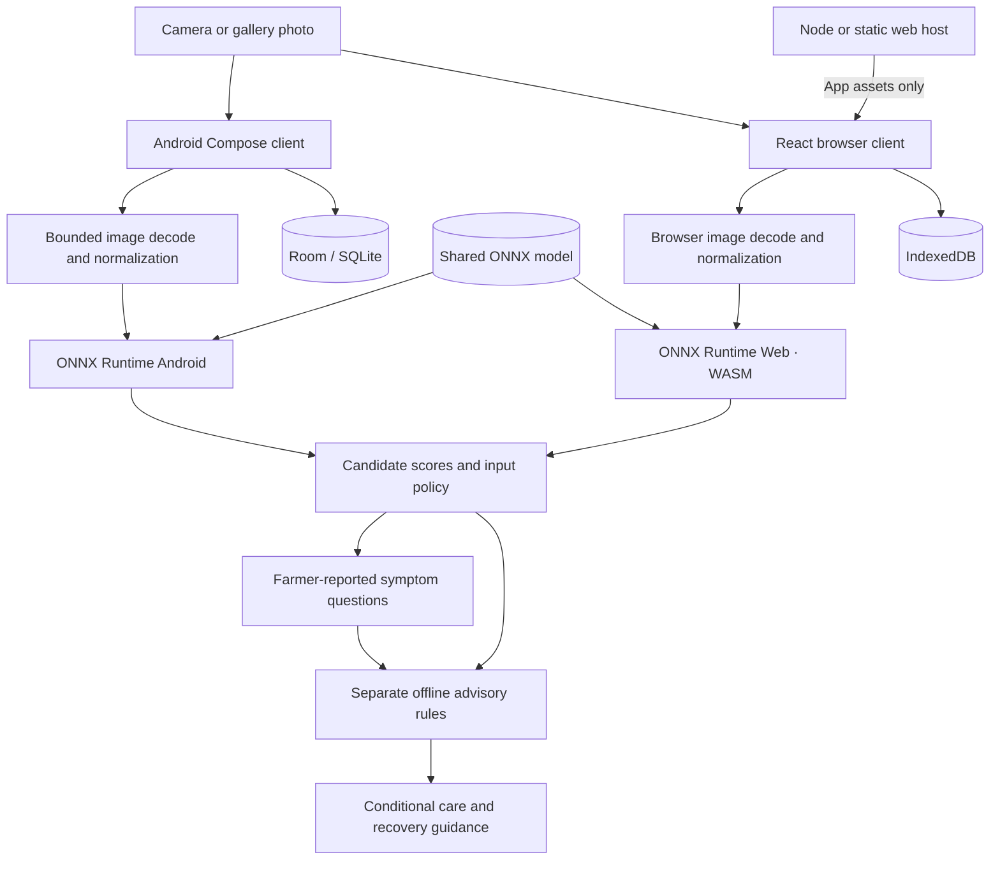

# Repository structure and source of truth

AgriScan has a native Android client and a browser client. Both run the same packaged MobileNetV3-Large ONNX model locally. The Node host serves browser files and a health endpoint; it does not receive photos or perform inference.

## Top-level map

```text
Build_Beyond/
├── android/       Kotlin/Compose app, local storage, and Android tests
├── frontend/      React/TypeScript app, browser storage, and web tests
├── backend/       Static preview server and health endpoint
├── models/        Canonical exported ONNX model and model metadata
├── content/       Authored model profiles, care protocols, and generators
├── ml/            Dataset preparation, training, evaluation, and export
├── contracts/     Stable model labels and preprocessing fixtures
├── database/      Room schema and IndexedDB documentation
├── scripts/       Build and offline-web packaging
├── tools/         Content/model bundle validation and acquisition tools
├── docs/          Architecture, setup, evaluation, evidence, and reports
└── presentations/ Current project presentation
```

## Where to make changes

| Change | Edit the canonical source |
|---|---|
| Disease model, class labels, decision policy, model metadata | `models/assets/model/` |
| Image model training/evaluation | `ml/crop_ml/` and the corresponding `ml/reports/` receipts |
| Stable label taxonomy and preprocessing contract | `contracts/` |
| Authored advisory rules and translations | `content/advisory_model.json`, `content/catalog.source.json`, and related `content/` sources |
| Detailed treatment/recovery protocols | `content/care_protocols.json` |
| Android UI and workflow | `android/app/src/main/java/com/debuggers/crophealth/` |
| Web UI and workflow | `frontend/src/` |
| Android packaged app content/audio | Built from the shared/generated assets described below; use the bundle builders rather than hand-editing a copy |
| Persistence contracts | `database/` plus the Android Room/browser storage implementation |
| Browser/Android build behavior | `scripts/`, root Gradle files, and app build configuration |

### Generated and packaged assets

Several copies are generated so each client can run fully offline. Edit the canonical source, then rebuild the package; do not hand-edit generated copies.

- `models/assets/model/` is the canonical exported ONNX model and metadata. Android reads it through Gradle's shared model asset source set.
- `content/` contains authored advisory and care sources. `tools/build_advisory_bundle.py` and `tools/build_care_protocols.py` validate/package their corresponding content in `android/app/src/main/assets/content/`.
- Audio source scripts/manifests and generated recordings live under `content/` and `android/app/src/main/assets/audio/`.
- `scripts/sync-web-assets.mjs` copies the canonical model plus Android-packaged content/audio into ignored `frontend/public/assets/`. It verifies care bundle hashes and the model checksum.
- `npm run build` writes ignored `frontend/dist/` and generates its service-worker cache and offline manifest.
- Android Gradle outputs, including APKs and generated web assets, live under ignored `android/app/build/`.
- `dist/` at the repository root is local delivery/evaluation output and is ignored by Git.

## Runtime architecture



## Client responsibilities

### Browser

`frontend/src/App.tsx` currently owns screen state and connects the browser workflows. Supporting modules divide inference (`lib/inference.ts`), advisory decisions (`lib/advisory.ts`), care-protocol selection (`lib/careProtocols.ts`), translations/assets (`lib/content.ts`), local records (`lib/storage.ts`), and offline cache registration (`lib/offline.ts`). Reusable panels and audio/treatment components are in `frontend/src/components/`.

The screen controller is large; extract screen components incrementally with explicit props and browser workflow coverage. Avoid turning one broad refactor into simultaneous changes to navigation, inference, and storage.

### Android

The application entry point is `MainActivity.kt`. Under `android/app/src/main/java/com/debuggers/crophealth/`, `ui/` contains Compose screens/theme/camera, `presentation/` contains ViewModel and screen state, `domain/` contains conditions/advisory/care logic, `inference/` contains ONNX runtime and bounded photo preprocessing, `data/` contains Room/photo/preferences storage, and `content/` loads packaged catalogs/protocols.

`CropHealthApp.kt` currently contains most Compose screen rendering. Split its screen composables separately from navigation/state changes, preserving the existing domain/UI tests.

### Data and server

Android observation metadata is stored in Room/SQLite and photos in app-private storage. The browser stores observation metadata and photo Blobs in IndexedDB. Each client has independent device-local history; there is no account, synchronization server, or cloud database.

`backend/server.mjs` serves `frontend/dist` and `GET /api/health`. The browser can also be hosted as static files. Neither host accepts crop photos or runs diagnosis.

## Model boundary

The current disease model uses ImageNet-pretrained MobileNetV3-Large visual features and a trained 17-class disease head, with a separate leaf/object check. It has not been validated for field diagnosis. The authored symptom/advisory model is a separate rule/profile system, not a trained severity network. The model card, exact artifacts, metrics, and limitations are in `models/assets/model/`, `ml/reports/`, and the [evaluation documentation](MODEL_RETRAINING_VALIDATION.md).

## Offline behavior

The installed Android app includes required model, content, and audio assets; inference and records do not require network access. The browser needs one successful asset load over HTTPS or localhost before its service worker can provide offline reload. **Offline ready** means required assets are cached, not that model predictions have been field-validated. Browser and Android history can be removed when the user clears the corresponding local app/browser data.
